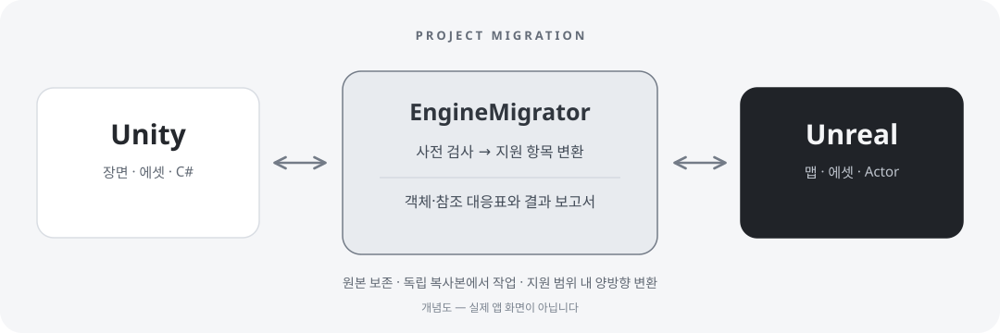

<p align="center">
  
</p>
<h1 align="center">EngineMigrator</h1>
<p align="center"><a href="README.md"></a> &nbsp; <strong>한국어</strong></p>
<p align="center"><strong>Unity ↔ Unreal, 프로젝트를 잇다.</strong></p>
<p align="center">
  <a href="docs/guide.html">사용 가이드</a> &middot;
  <a href="docs/development-status.md">지원 범위 · 검증 기록</a> &middot;
  <a href="#시작하기">시작하기</a>
</p>

---

Windows용 Unity ↔ Unreal 프로젝트 포팅 도구입니다. 장면·리소스와 지원 스크립트를 대상 엔진의 객체로 변환하고, 원본과 결과의 대응 관계를 보고서로 남깁니다.

<p align="center">
  
</p>
<p align="center"><sub>지원 항목의 변환을 설명하는 개념 일러스트이며, 렌더링 외형의 동등성을 보장하지 않습니다.</sub></p>
**개발 프리뷰입니다.** 전체 게임·임의 코드·모든 엔진 버전의 자동 포팅은 아직 완성되지 않았습니다. 지원하지 않는 항목은 차단 사유로 기록합니다.

<p align="center">
  
</p>

## 주요 기능

- **장면과 리소스** — 계층·Transform, 기본 메시·텍스처·머티리얼, 카메라·조명과 일부 환경 설정 이전
- **스크립트와 참조** — 지원하는 MonoBehaviour ↔ Runtime Actor 변환, 직렬화 값·객체 참조·상속·생명주기 처리
- **프로젝트 왕복** — 지원 장면·프리팹의 변환과 복원, 원본 ID·리소스·참조 대응표 제공
- **독립 복사본 작업** — 원본·대상 프로젝트를 보존하고 결과 폴더 아래의 복사본에서 처리

세부 지원 조건과 제한은 [사용 가이드](docs/guide.html) 및 [개발·검증 기록](docs/development-status.md)을 확인해 주세요. 일반 게임플레이·렌더링·물리·패키징 전체의 동등성은 보장하지 않습니다.

## 시작하기

Windows와 .NET 9 SDK / Windows Desktop 런타임이 필요합니다. 실제 변환에는 프로젝트와 일치하는 Unity·Unreal 버전이 설치되어 있어야 하며, Unreal C++ 생성에는 호환되는 Visual Studio C++ 빌드 도구가 필요합니다.

```powershell
git clone https://github.com/MDJ0126/EngineMigrator.git
cd EngineMigrator
./Start-EngineMigrator.ps1
```

앱에서 원본·대상 프로젝트와 변환 방향을 선택하고 **사전 검사 → 장면·리소스 포팅 → 변환 대응표 확인** 순서로 진행합니다. 공개 설치 패키지 대신 현재는 소스에서 실행합니다.

> 이 체크아웃에는 엔진 실행 사고 방지 가드가 포함되어 있습니다. 앱 실행과 실제 엔진 실행은 별개이며, 엔진 작업은 안전 사전 검사와 허용된 실행 경로를 충족해야 합니다. 자세한 운영 제한은 [AGENTS.md](AGENTS.md)를 확인해 주세요.

## 문서

| 문서 | 내용 |
| --- | --- |
| [사용 가이드](docs/guide.html) | 사용 흐름, 변환 대응표, 제한과 문제 해결. HTML 파일을 내려받아 브라우저에서 열어 보세요. |
| [개발·검증 기록](docs/development-status.md) | 세부 기능, 기존 실행 검증 범위, 미완료 항목과 개발 명령 |

기존 실행 검증 환경은 Unity **6000.0.83f1**, Unreal **5.8.1 / 5.5.4**입니다. 해당 환경의 제한된 사례에 대한 기록이며, 모든 프로젝트와 버전의 호환성을 의미하지 않습니다.
