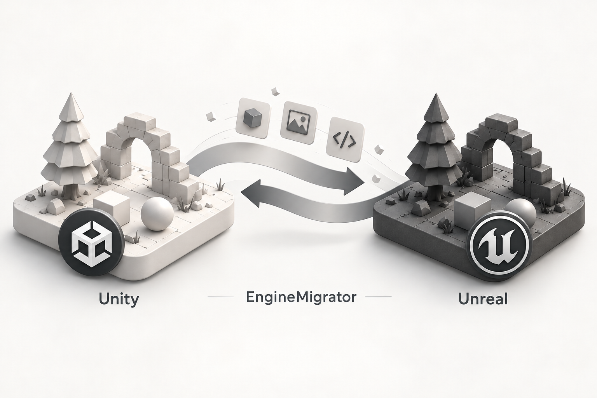

<p align="center">
  
</p>
<h1 align="center">EngineMigrator</h1>
<p align="center"><strong>Bridging projects between Unity and Unreal.</strong></p>
<p align="center"><strong>English</strong> &nbsp; <a href="README.ko.md"></a></p>
<p align="center">
  <a href="docs/guide.html">User guide (한국어)</a> &middot;
  <a href="docs/development-status.md">Support &amp; validation (한국어)</a> &middot;
  <a href="#getting-started">Getting started</a>
</p>

---

A Windows tool for porting projects between **Unity and Unreal Engine**. Convert supported scenes, assets and scripts into objects in the target engine, with reports that map the originals to their results.

<p align="center">
  
</p>
<p align="center"><sub>Concept illustration of supported content migration; visual equivalence is not guaranteed.</sub></p>

**Development preview.** Automatic conversion of entire games, arbitrary code and every engine version is not complete. Unsupported content is reported with a blocking reason.

## How it works

<p align="center">
  
</p>

## Features

- **Scenes and assets** — Transfer hierarchies, transforms, basic meshes, textures and materials, cameras, lights and selected environment settings.
- **Scripts and references** — Convert supported MonoBehaviour ↔ Runtime Actor code, including serialized values, object references, inheritance and lifecycle behavior.
- **Project roundtrips** — Convert and restore supported scenes and prefabs, with mappings for original IDs, assets and references.
- **Separate working copies** — Preserve the source and target projects; process copies inside the output folder.

See the [user guide](docs/guide.html) and [development and validation notes](docs/development-status.md) for detailed conditions and limitations. These documents are currently in Korean. Full gameplay, rendering, physics and packaging equivalence is not guaranteed.

## Getting started

Requires **Windows**, the **.NET 9 SDK** and the **Windows Desktop runtime**. Conversion also requires installed Unity and Unreal versions matching your projects. Unreal C++ generation requires compatible Visual Studio C++ build tools.

```powershell
git clone https://github.com/MDJ0126/EngineMigrator.git
cd EngineMigrator
./Start-EngineMigrator.ps1
```

In the app, select the source and target projects and the conversion direction. Follow **preflight inspection → scene and asset porting → review conversion mappings**. Run from source for now; a public installer is not provided.

> This checkout includes engine execution safeguards following a security-dialog incident. Starting the app and launching an engine are separate operations. Engine tasks require safety preflight checks and an allowed execution path. See [AGENTS.md](AGENTS.md) for operational restrictions.

## Documentation

| Document | Contents |
| --- | --- |
| [User guide (한국어)](docs/guide.html) | Workflow, conversion mappings, limitations and troubleshooting. Download the HTML file and open it in a browser. |
| [Development and validation notes (한국어)](docs/development-status.md) | Detailed support, previous execution checks, unfinished work and development commands. |
| [한국어 README](README.ko.md) | Korean introduction and setup instructions. |

Previously tested environments include Unity **6000.0.83f1** and Unreal **5.8.1 / 5.5.4**. These records cover limited cases in those environments, not compatibility with all projects or versions.
